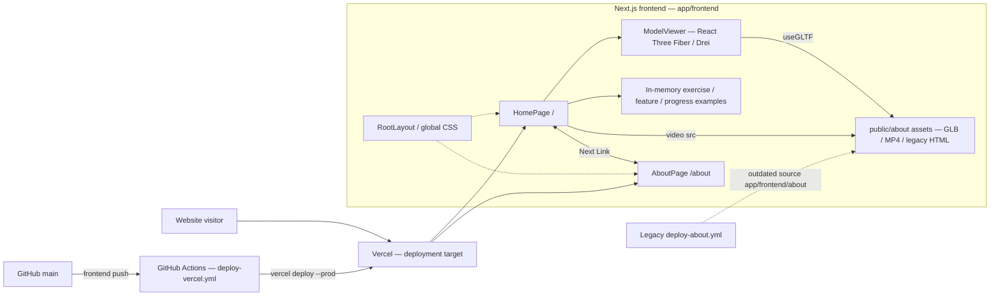
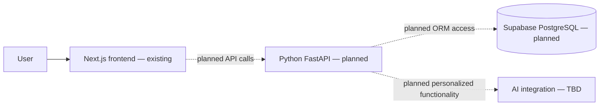

# Section 4 -- High-level System Architecture

Source: `SFSU-CSC648-TeamOne/SFSU-csc648-06-Fall26-team01`, `main`, Git tree `8b2a61d5905f8721f7dd63f351e08777b45cb3a0`.

## Implemented component / dependency diagram

**Evidence:** `app/frontend/app/page.tsx` imports `ModelViewer` and defines hardcoded `features` and `exercises` arrays; `app/frontend/app/about/ModelViewer.tsx` loads a `.glb` asset via Drei; `app/frontend/app/layout.tsx` imports `globals.css`; GitHub Actions `deploy-vercel.yml` invokes Vercel CLI. The `deploy-about.yml` workflow uses `app/frontend/about/*`, a source directory missing on current main. These are code/configuration relationships, not proof of live deployment availability.

## Documented target design (not implemented)

The README lists Python, FastAPI, SQLAlchemy and Supabase/PostgreSQL as the intended stack. `app/backend` contains only `.gitkeep`. No runtime API calls or database client imports were identified in the inspected Next.js route and component files. The target diagram must not be interpreted as running functionality.

## Caveats

- The legacy HTML in `app/frontend/index.html` and `public/about/**/*.html` is separate from Next.js App Router pages.
- Repository configuration shows an intended deployment path, not verified deployment health.
- The Mermaid file and corresponding UML component `.puml` files should be updated after new backend/API components are merged.
- To preview `.puml` in VS Code, install the PlantUML extension; `architecture.md` previews with the built-in Markdown preview (`Ctrl+K`, then `V`).
