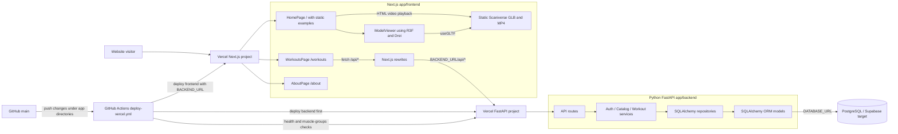
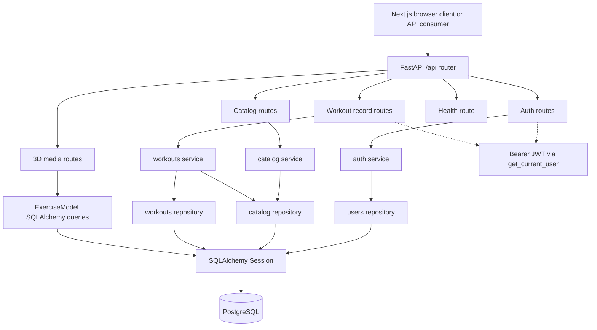
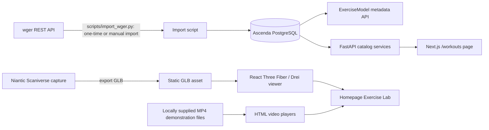

# Section 4 — High-Level System Architecture

**Project:** Ascenda — CSC 648/848, Section 06, Team 1  
**Review basis:** GitHub `SFSU-CSC648-TeamOne/SFSU-csc648-06-Fall26-team01`, `main`, commit `9139ccd99c76c22e8c452f80d4b1d7cc2fb2d5c6` (October 20, 2026 UTC).

## 4.1 Implemented component and deployment architecture

**Evidence:** `app/frontend/app/workouts/page.tsx` fetches `/api/muscle-groups`, `/api/workout-sessions` and `/api/workout-sessions/{id}`. `app/frontend/next.config.ts` rewrites `/api/:path*` to `BACKEND_URL/api/:path*`. `app/backend/app/main.py` includes the FastAPI router under `/api`; `app/backend/app/db/session.py` creates a SQLAlchemy engine with `DATABASE_URL`. `.github/workflows/deploy-vercel.yml` deploys the backend, tests `/api/health` and `/api/muscle-groups`, then deploys the frontend using the backend URL. The preceding description is implementation/configuration evidence, not confirmation of a successfully completed production workflow run.

## 4.2 Backend internal components

Routes implemented in source (all paths below are relative to `/api`):

| Category | Methods and paths | Purpose |
|---|---|---|
| Health | `GET /health` | Liveness response, not a full database readiness test |
| Authentication | `POST /auth/register`, `POST /auth/login`, `GET /auth/me` | Create user, issue/access bearer token, return current user |
| Exercise catalog | `GET /exercises`, `GET /exercises/{exercise_id}` | Search by text, muscle, equipment, difficulty; detail |
| Lookups | `GET /equipment`, `GET /muscle-groups` | Filter choices |
| Programs | `GET /programs` | Search by goal and maximum weeks |
| Workout sessions | `GET /workout-sessions`, `GET /workout-sessions/{session_id}` | Search by muscle, difficulty, maximum minutes; view exercise prescriptions |
| Workout history | `POST /workout-records`, `GET /workout-records`, `GET /workout-records/{record_id}` | Save and retrieve authenticated user's records |
| Spatial media | `GET /exercise-models`, `GET /exercises/{exercise_id}/model` | Retrieve stored 3D model/video metadata |

**Current frontend scope:** The `/workouts` page exercises the **workout-session** listing/detail API with muscle, difficulty and time filters. The main landing page's exercise catalog still displays local hardcoded examples and static visual mockups. The presence of auth/workout-record backend routes does not mean registration, assessment, or logging screens are integrated with them.

## 4.3 Database organization (SQLAlchemy models)

The following entities are defined in the current backend ORM. Exact column types and constraints are defined in `app/backend/app/models/` and should be matched to Data Definitions V2.

| Tables | Representative columns and role |
|---|---|
| `users`, `user_profiles`, `assessments` | User credentials/role; preferences and equipment; assessment answers, score and experience level |
| `equipment`, `muscle_groups`, `exercises` | Reference equipment and muscles; exercise descriptions, difficulty, default duration/role, wger provenance and credits |
| `exercise_equipment`, `exercise_muscles`, `user_equipment` | Association rows between exercises, muscles, and equipment, and a user's available equipment |
| `training_programs`, `workout_sessions`, `session_exercises` | Programs; ordered workouts; prescribed exercises with `role`, sets, reps and minutes |
| `workout_records`, `performance_entries` | User's performed workout, timing and notes; sets/reps/load/duration/substitution details |
| `exercise_models` | Per-exercise model URL, optional video URL, optional animation name, credit |

### Database operations currently represented in code

| Entity area | Read / search | Create / update / delete |
|---|---|---|
| Catalog, programs and sessions | Filtered reads and details via repository/service/routes | Import scripts seed/update catalog; no public catalog write routes observed |
| User account | Look up by email/id and `/auth/me` | Registration creates `users`; no profile-edit route observed |
| Assessment | ORM entity defined | No assessment submission or scoring API route observed |
| Workout records/entries | User-scoped history and detail | Authenticated record creation; no record-edit/delete route observed |
| Exercise model metadata | List and detail lookup | Script `scripts/attach_models.py` can attach metadata; no public upload route observed |

This is an overview of the **code-defined schema**. A successful production migration or populated Supabase database has not been independently verified by this source review.

## 4.4 Third-party data and spatial media

The import script calls wger externally during import; routine website requests read Ascenda's own database rather than wger live. The script assigns Ascenda-derived default difficulty, core/accessory role and duration; these should not be presented as wger's own classifications. The current Scaniverse GLB and exercise MP4 videos appear as **separate** components on the homepage. `exercise_models`/media routes provide an additional backend metadata path, but the existing homepage viewer uses a hardcoded asset URL. There is no verified live Niantic REST API call, video spatial anchoring, 360° recording, or volumetric playback in the inspected source.

## 4.5 Architecture risks, caveats and verification

1. **Live vertical prototype:** Code paths now exist for browser → FastAPI → SQLAlchemy → PostgreSQL, but demonstrate populated search results from the **deployed website**, not only source code or a `/health` response.
2. **Deployment:** Backend-first GitHub Actions workflow exists; verify the latest run, deployment aliases, correct `BACKEND_URL`, and production database connectivity. Deployment is not established solely by YAML.
3. **Frontend vs backend coverage:** `/workouts` is API-backed; the homepage catalog/search controls remain presentation examples, and assessment/adaptation have no demonstrated corresponding automated frontend workflow.
4. **Legacy workflow:** `.github/workflows/deploy-about.yml` still references `app/frontend/about/*`, which does not appear in the inspected `main` tree; the Next.js App Router's `/about` is at `app/frontend/app/about/`.
5. **Security/configuration:** JWT-authenticated workout-record endpoints exist. Confirm secrets are configured in deployment and CORS permits only intended origins; never include real `.env` values in M2 documentation.
6. **Licensing/media:** Confirm applicable attribution and licenses for imported wger content, Scaniverse assets and exercise video, and distinguish supported MP4 playback from planned immersive video.
7. **Documentation synchronization:** This file replaces the old assertion that `app/backend` contains only `.gitkeep`. Update the review commit and diagrams after any final changes to `main`.

**Implementation source links:** [repository](https://github.com/SFSU-CSC648-TeamOne/SFSU-csc648-06-Fall26-team01); [`/workouts` UI](https://github.com/SFSU-CSC648-TeamOne/SFSU-csc648-06-Fall26-team01/blob/main/app/frontend/app/workouts/page.tsx); [FastAPI routes](https://github.com/SFSU-CSC648-TeamOne/SFSU-csc648-06-Fall26-team01/tree/main/app/backend/app/api/routes); [ORM models](https://github.com/SFSU-CSC648-TeamOne/SFSU-csc648-06-Fall26-team01/tree/main/app/backend/app/models); [deployment workflow](https://github.com/SFSU-CSC648-TeamOne/SFSU-csc648-06-Fall26-team01/blob/main/.github/workflows/deploy-vercel.yml).
