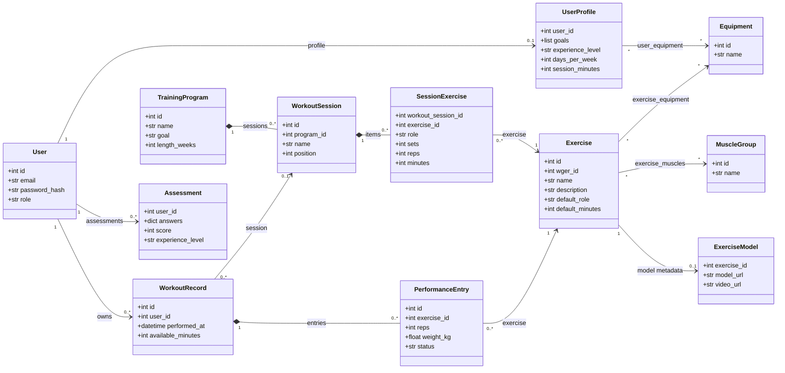
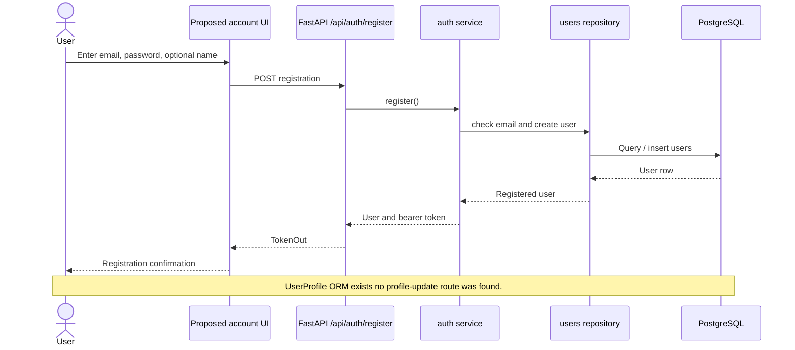
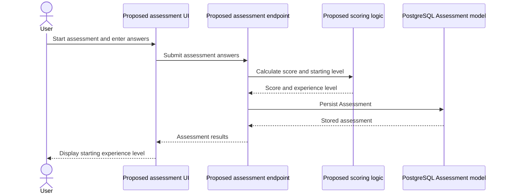
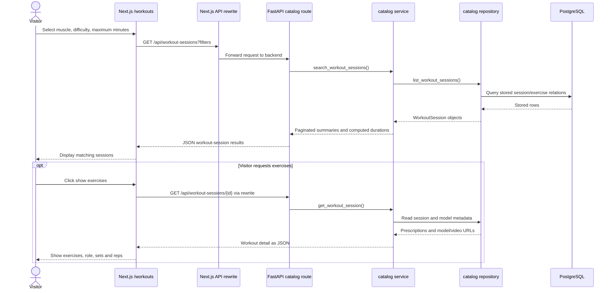
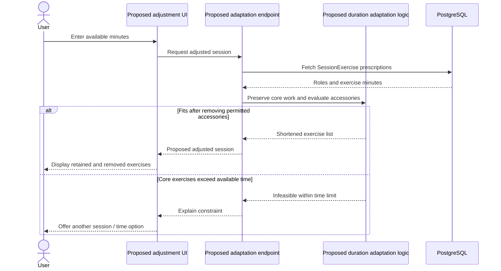
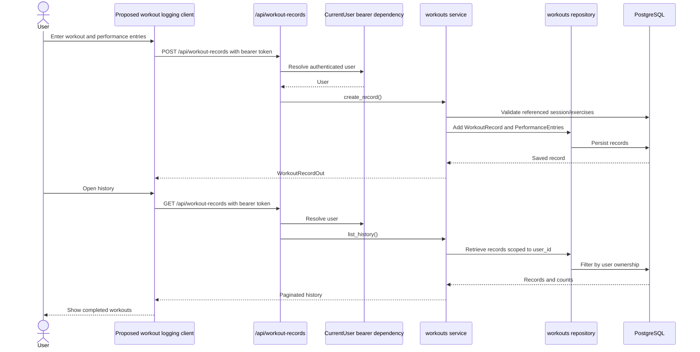
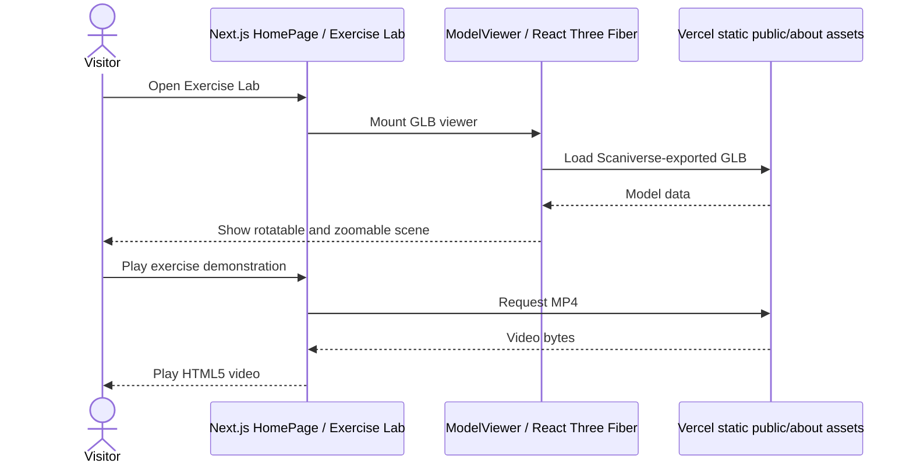

# Section 5 — High-Level UML Diagrams

**Project:** Ascenda — CSC 648/848, Section 06, Team 1  
**Milestone:** M2 — October 20, 2026  
**Source snapshot:** GitHub `main`, commit `9139ccd99c76c22e8c452f80d4b1d7cc2fb2d5c6` (October 20, 2026 UTC).

**Status convention:** *Implemented in source* indicates relevant backend classes, routes or frontend components exist. *Proposed* means the described behavior is not implemented. All sequences show logical calls; they do not establish deployed service health or populated database records.

## 5.1 High-level UML class diagram — implemented core domain model

The diagram uses selected **actual SQLAlchemy ORM classes** in `app/backend/app/models/`. It is high-level rather than a complete database entity-relationship diagram. `SessionExercise.role` and `SessionExercise.minutes` override or contextualize an `Exercise`'s defaults. `Assessment` is a persisted model; automated evaluation of its results is not represented as implemented. `ExerciseModel` stores metadata rather than playing videos itself.

**Scope:** Additional attributes, primary/foreign keys, check constraints, join-table classes (including `ExerciseMuscle` with `is_primary`), serializers, repositories and service modules are present in the source but omitted for readability. Not all represented ORM classes have corresponding user-facing web screens.

## 5.2 High-level UML sequence diagrams

### 5.2.1 Registration and profile setup — R1/R2 (registration implemented in backend; profile editing proposed)

The backend also implements `POST /api/auth/login` and `GET /api/auth/me`; it uses password hashing and a bearer-token dependency. The Next.js account-registration/profile workflow is not shown as implemented.

### 5.2.2 Initial fitness assessment — R4 (proposed application flow)

`app/backend/app/models/users.py` defines `Assessment` (`answers`, `score`, `experience_level`) but no implemented assessment endpoint/service or scoring rules were identified in the reviewed source.

### 5.2.3 Filter and view workout sessions — R3/R5/R6 (implemented frontend/backend integration path)

The `/workouts` page and FastAPI routes exist in source. The **homepage** exercise catalog still contains hardcoded examples; this diagram does not claim the homepage search controls are connected. Filtering sessions by `max_minutes` is implemented; dynamically modifying a selected workout to fit a time budget is not.

### 5.2.4 Adapt workout to available time — R6 (proposed advanced adaptation)

The actual backend exposes `SessionExercise.role` and computed workout durations, but no implemented `adapt-session` endpoint or dynamic exercise-removal algorithm was identified. Therefore this is an intended enhancement, distinct from current listing filters.

### 5.2.5 Log workout and retrieve history — R8/R9 (backend implemented; frontend integration unverified)

Authentication, write/read routes, validation and user-scoped history retrieval are implemented in the backend source. The inspected Next.js routes do not demonstrate a connected workout logging/history screen.

### 5.2.6 View Scaniverse exercise demonstration — R3 supporting feature (implemented frontend)

The GLB model and MP4 demonstrations remain separate media elements in the homepage. The backend additionally defines an `ExerciseModel` table and read endpoints for linked model/video metadata, but the hardcoded homepage GLB viewer does not use that API. No live Niantic REST call, in-scene video plane, 360° recorded playback or volumetric capture is established by this diagram.

## 5.3 Traceability and implementation status

| Sequence | M1 requirement(s) | Status at source snapshot |
|---|---|---|
| Registration and profile | R1, R2 | Registration/auth endpoints implemented in backend; profile UI/updates proposed |
| Initial fitness assessment | R4 | Assessment ORM exists; scoring and submission flow proposed |
| Filter/view workout sessions | R3, R5, R6 | Next.js `/workouts` and database-backed API code exists; deployed dataset not verified |
| Adapt workout to available time | R6 and core/accessory concept | Prescribed roles/durations implemented; adaptive re-planning proposed |
| Log workout and view history | R8, R9 | Backend implemented; user-facing UI integration unverified |
| Spatial exercise demonstration | R3 | Homepage React Three Fiber GLB viewer + independent MP4 playback implemented |

## 5.4 Verification notes for M2 submission

1. Compare attributes against the final Data Definitions V2. The class diagram reflects current backend code, which may not represent every element of the team's planned conceptual data model.
2. Demonstrate `/workouts` returning real persisted workout sessions and detail on the live deployed site; a source-level FastAPI route is not proof of production DB content.
3. Do not describe Niantic capture as a live backend API integration. It is currently an exported GLB embedded in the web product.
4. Treat the registered user's experience assessment and adaptive session modification as proposed unless separately implemented after this commit.
5. If Section 5 is placed in the final DOCX, preserve the headings and Mermaid previews as rendered diagrams/images (rather than raw code blocks) according to instructor formatting.
