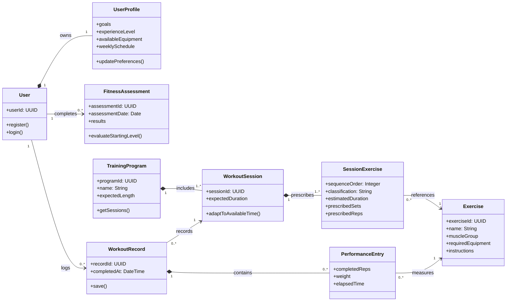
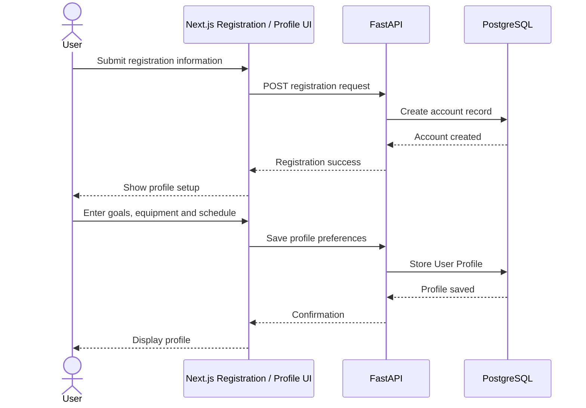
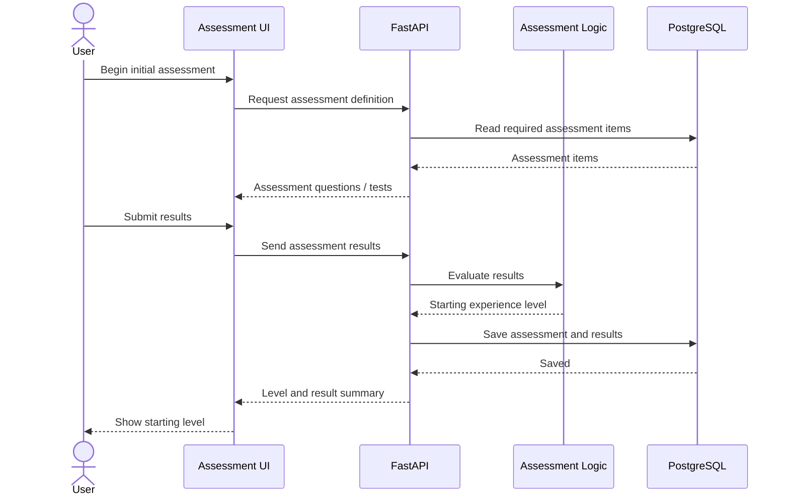
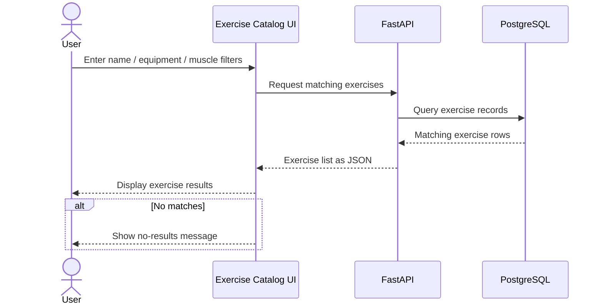
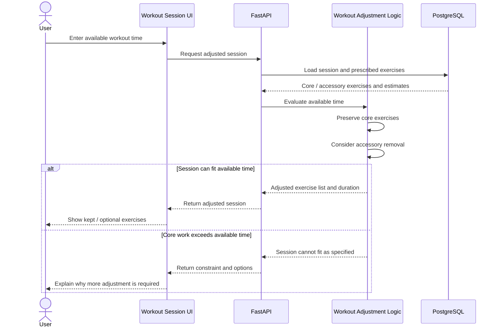
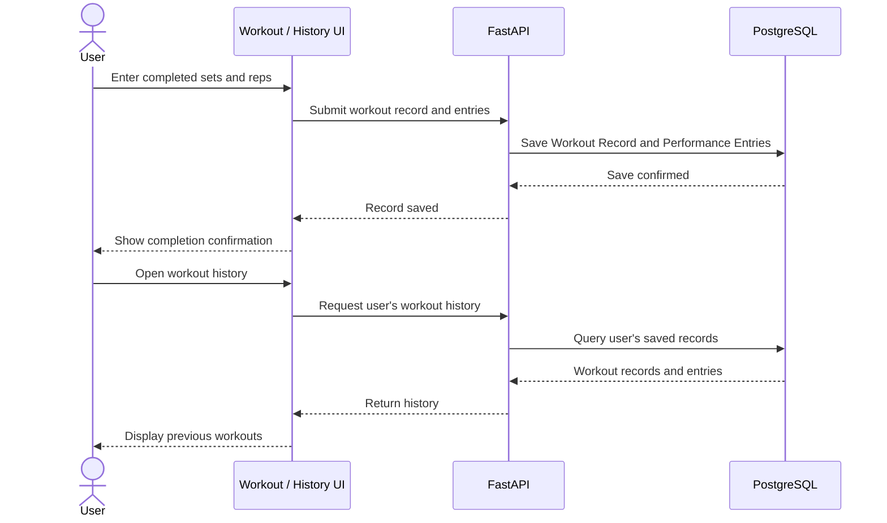
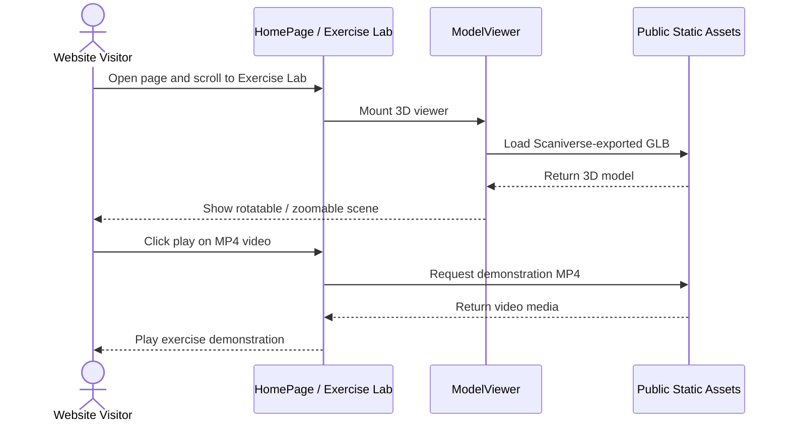

Section 5 — High-Level UML Diagrams
Project: Ascenda — CSC 648/848, Section 06, Team 1
Milestone: M2 (October 20, 2026)
These diagrams describe Ascenda's core application objects and six representative functional flows. Unless explicitly marked “implemented,” diagrams show the proposed M2 design, not functionality confirmed to be running. The current repository snapshot includes a Next.js frontend with static exercise examples and a Scaniverse-derived 3D model viewer with separate MP4 exercise demonstrations. The FastAPI and PostgreSQL integration is a target design pending implementation verification.
5.1 High-Level UML Class Diagram — Proposed Design
The class diagram focuses on Ascenda's main domain objects. SessionExercise links a reusable Exercise to an individual WorkoutSession; its core/accessory designation and duration depend on the session, not on the exercise catalog entry. The diagram models intended application responsibilities, not a claim that these classes have already been implemented.

Scope note: The training-program association to a specific user, full assessment definitions, substitutions, physical constraints, gym data, and historical program snapshots belong in the expanded data model but are omitted here to keep this high-level class diagram readable. Attributes are conceptual, and their exact names/types must be aligned with the team's approved M2 Data Definitions V2 before final submission.
5.2 UML Sequence Diagrams
5.2.1 Registration and Profile Setup — R1, R2 (Proposed)

The authentication provider and exact endpoint paths are not finalized in the inspected repository; this is the intended interaction, not a claim of a working authentication flow.
5.2.2 Initial Fitness Assessment — R4 (Proposed)

Assessment questions, scoring rules, and whether an assessment modifies the user profile must be specified in the functional requirements and data definitions; this diagram does not invent those policies.
5.2.3 Exercise Catalog Search — R3, R5 (Proposed Vertical Prototype)

Acceptance criterion for the M2 vertical prototype: list and search exercises stored in the database via the deployed frontend, API, and database. The currently inspected frontend instead displays hardcoded exercise examples, so this sequence remains a target until the integration is demonstrated.
5.2.4 Adapt Workout to Available Time — R6 (Proposed)

A session-level classification distinguishes core from accessory work. The model does not assume that removing accessories always makes a workout fit the available time.
5.2.5 Log Workout and View History — R8, R9 (Proposed)

Workout data should be scoped to the authenticated user in the eventual implementation; access-control details are omitted here because the diagram is high-level.
5.2.6 View Spatial Exercise Demonstration — R3 Supporting Demonstration (Implemented Frontend)

Implementation boundary: The current React Three Fiber viewer loads a Scaniverse-derived .glb asset, while standard HTML video players play separate .mp4 files on the same page. The exercise video is not yet positioned or rendered inside the 3D environment, and the demo does not establish 360-degree video or volumetric capture. This is an R3 exercise-demonstration use case; do not label it R13 unless the team's Functional Requirements V2 explicitly renumbers or expands that requirement (M1 R13 covers scanned-equipment details).
5.3 Traceability and Implementation Status
Diagram	Relevant M1 requirements	Status at reviewed repository snapshot
Registration / Profile	R1, R2	Proposed
Initial Fitness Assessment	R4	Proposed
Exercise Catalog Search	R3, R5	Proposed vertical prototype; current examples are hardcoded
Workout Duration Adjustment	R6, core/accessory concept	Proposed
Workout Logging and History	R8, R9	Proposed
Spatial Exercise Demonstration	R3 exercise demonstrations	Implemented frontend demonstration with separate model and videos

The diagrams should be checked against the final code, database relations, and the team's approved Data Definitions V2 before the M2 document is submitted. This Markdown file is the working source for Section 5; the final consolidated milestone document must retain the course-required section numbering and formatting.